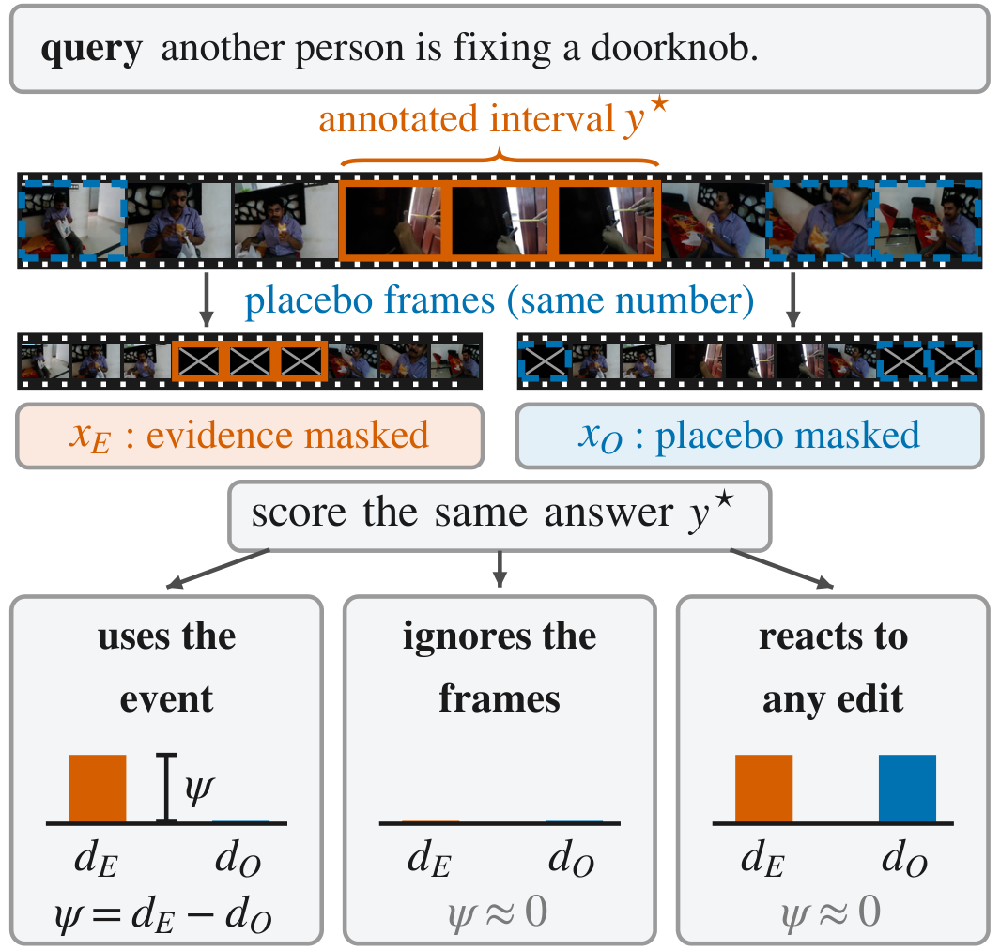
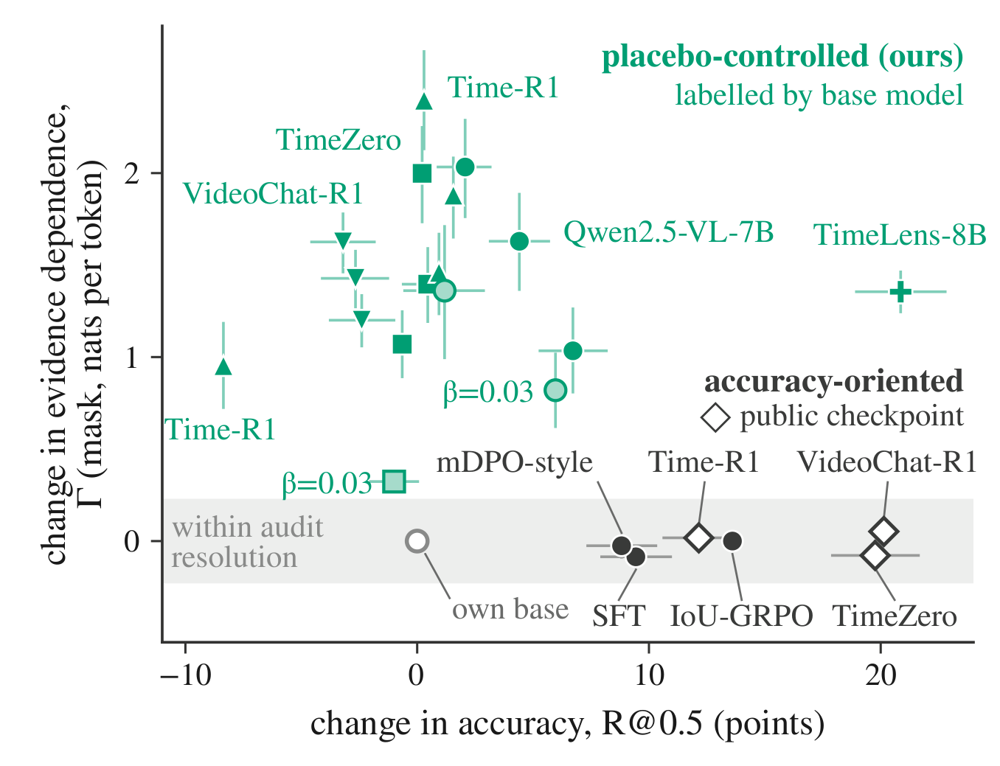

# Accuracy Is Not Evidence: Measuring and Training Evidence Dependence in Video Temporal Grounding

**Zijie Jin**<sup>1</sup>, **Shuai Zhao**<sup>1,†</sup>, **Haoran Tao**<sup>2</sup>, **Chaomin Huang**<sup>3</sup>, **Liwen Luo**<sup>4</sup>

<sup>1</sup>Beijing University of Posts and Telecommunications &nbsp; <sup>2</sup>Institute of Automation, Chinese Academy of Sciences &nbsp; <sup>3</sup>Peking University &nbsp; <sup>4</sup>Independent Researcher &nbsp; <sup>†</sup>Corresponding author

[Homepage](https://jinzijie-bupt.github.io/Accuracy-Is-Not-Evidence/) · [Paper (arXiv)](https://arxiv.org/abs/2611.30320) · [Models](#released-models) · [Data](https://huggingface.co/datasets/jinzijie-bupt/Accuracy-Is-Not-Evidence)

<p align="center"> </p>

In video temporal grounding, a correct interval can come from finding the event, answering blind or fitting one annotation style, and Recall at IoU scores them alike. We measure **evidence dependence**, how much the answer rests on the event's frames. The fixed-answer audit edits either the frames inside the annotated interval or, as a placebo, as many frames elsewhere in the same video, and compares the two drops in the annotated answer's likelihood. Post-training for accuracy leaves evidence dependence where it was. Because the comparison is a difference of the model's own likelihoods, we can train on it. The placebo-controlled objective raises evidence dependence in all five base models we train, and added to IoU-reward training it keeps the accuracy gain.

This repository holds the code, data identifiers and table and figure scripts of the paper. Per-question outputs are in the [Hugging Face dataset](https://huggingface.co/datasets/jinzijie-bupt/Accuracy-Is-Not-Evidence) and the trained LoRA adapters in the model repositories below.

## Released models

LoRA adapters, one repository each. Every model card lists the tables and figures the model appears in, its training settings and the transformers version to load it with.

| Model | Base | Training |
|---|---|---|
| [`evidence-audit-qwen7b-pc-a05-s0`](https://huggingface.co/jinzijie-bupt/evidence-audit-qwen7b-pc-a05-s0) | Qwen2.5-VL-7B-Instruct | placebo-controlled objective, α = 0.5 (main model) |
| [`evidence-audit-timezero7b-pc-a05-s0`](https://huggingface.co/jinzijie-bupt/evidence-audit-timezero7b-pc-a05-s0) | TimeZero-Charades-7B | placebo-controlled objective, α = 0.5 |
| [`evidence-audit-timer1-7b-pc-a05-s0`](https://huggingface.co/jinzijie-bupt/evidence-audit-timer1-7b-pc-a05-s0) | Time-R1-7B | placebo-controlled objective, α = 0.5 |
| [`evidence-audit-videochatr1-7b-pc-a05-s0`](https://huggingface.co/jinzijie-bupt/evidence-audit-videochatr1-7b-pc-a05-s0) | VideoChat-R1-7B | placebo-controlled objective, α = 0.5 |
| [`evidence-audit-timelens8b-pc-a05-s0`](https://huggingface.co/jinzijie-bupt/evidence-audit-timelens8b-pc-a05-s0) | TimeLens-8B | placebo-controlled objective, α = 0.5 |
| [`evidence-audit-qwen7b-iougrpo-pc-lam001-s0`](https://huggingface.co/jinzijie-bupt/evidence-audit-qwen7b-iougrpo-pc-lam001-s0) | Qwen2.5-VL-7B-Instruct | IoU-GRPO plus the placebo-controlled term, λ = 0.01 |
| [`evidence-audit-timezero7b-iougrpo-pc-lam001-s0`](https://huggingface.co/jinzijie-bupt/evidence-audit-timezero7b-iougrpo-pc-lam001-s0) | TimeZero-Charades-7B | IoU-GRPO plus the placebo-controlled term, λ = 0.01 |
| [`evidence-audit-qwen7b-sft-s0`](https://huggingface.co/jinzijie-bupt/evidence-audit-qwen7b-sft-s0) | Qwen2.5-VL-7B-Instruct | SFT baseline |
| [`evidence-audit-qwen7b-iougrpo-2fps-s0`](https://huggingface.co/jinzijie-bupt/evidence-audit-qwen7b-iougrpo-2fps-s0) | Qwen2.5-VL-7B-Instruct | IoU-GRPO baseline at 2 fps |

The other trained models of the paper (further seeds, ablations, bound and α settings) are available from the authors on request.

## Layout

| Folder | Content |
|---|---|
| `code/` | Trainers, the likelihood audit, the accuracy and behavioural evaluators. |
| `readers/` | Readers that turn per-question outputs into the reported quantities (bootstrap over videos). |
| `results/` | Not in git. Download the [dataset](https://huggingface.co/datasets/jinzijie-bupt/Accuracy-Is-Not-Evidence) here: per-question outputs and reader products. |
| `tables_and_figures/` | `make_all.py` rebuilds every table and data figure of the paper from `results/`. |
| `data_ids/` | Training pairs, audit and generation question sets, placebo draws, query pairings, Charades-CD items. |
| `rebuttal/` | Job generators and readers of the experiments in Appendix F, and `indep600_qids.json` (the 600-question audit sample from videos outside the first 200). |
| `setup/` | `attn_launch.py` (run a script with every model load forced to an attention implementation, e.g. FlashAttention-2) and `wait_launch.py`. |
| `tools/` | `convert_adapter_tf5keys.py` (transformers 4.51 adapter -> transformers 5 key names) and `check_lora_keys.py` (catches an adapter that loads as a no-op). |
| `docs/` | Project homepage. |

`FILES.md` describes every file folder by folder.

```bash
git clone https://github.com/jinzijie-bupt/Accuracy-Is-Not-Evidence
cd Accuracy-Is-Not-Evidence
huggingface-cli download jinzijie-bupt/Accuracy-Is-Not-Evidence --repo-type dataset --local-dir . --include "results/*"
```

## Environments

Two software stacks were used, and an adapter must be loaded on the stack its model card names:

* `requirements-tf5.txt` - transformers 5.12 (most adapters, all evaluators with the `tf5meta` suffix, TimeLens-8B).
* `requirements-tf451.txt` - transformers 4.51.3 (adapters marked "transformers 4.51", the `tf451` evaluators, `29_`/`30_` GRPO trainers).
* `requirements-analysis.txt` - readers, tables and figures (CPU only).

Adapters trained on transformers 4.51 store module names that transformers 5 does not use; PEFT then loads them
silently as a no-op. Check before any evaluation:

```
python tools/check_lora_keys.py --adapter <adapter folder or hub repo> [--subfolder transformers-v5]
python tools/check_lora_keys.py --adapter <...> --base Qwen/Qwen2.5-VL-7B-Instruct --load
```

## Paths

Scripts take `--model`, `--adapter`, `--anno`, `--out` (and `--pairs` for the trainers). Defaults are built from
environment variables instead of machine paths:

| Variable | Used by | Meaning |
|---|---|---|
| `DATA_ROOT` | `code/12_charades_grounding.py` and everything importing it | holds `data/charades_sta/` (annotations and `Charades_v1_480/` videos) and `models/` |
| `WORK_ROOT` | `rebuttal/**/mk_*_jobs.py`, `rebuttal/navmr` | working directory on the GPU machine (`models/`, `results/`, the scripts in `probe3_selector_evidence/`); must be absolute for the job generators |
| `DATASETS_ROOT` | job generators | read-only mount where adapters were staged (`ds-1/`, `ds-2/`) |
| `LOCAL_ROOT` | `rebuttal/zero_gpu`, `rebuttal/readout_all.py`, `rebuttal/a6` | analysis directory holding the pulled `results/` |
| `SETUP_DIR`, `CHARADES_TEST_ANNO` | two job generators, `rebuttal/mk_indep_sample.py` | local job-file folder; Charades-STA test annotation |

Run names end in a compute-node tag (`node1` ... `node9`). Nodes 1-6 are the machines of the main runs
(`tables_and_figures/scripts/canonical_v2.py` maps them to software stacks); nodes 7-9 are the GPU workers of
the Appendix F runs (A100 80GB, both software stacks).

## Training

| Models | Trainer | Example |
|---|---|---|
| placebo-controlled objective, SFT, ablations, two-stage | `code/27_papo_train_qcdro_v3seln_r5.py` | `python code/27_papo_train_qcdro_v3seln_r5.py --pairs data_ids/training_pairs_pool_8434.jsonl --limit 2400 --model <base> --objective groupdro --npole --dro-group-standardize --alpha 0.5 --beta 0.1 --accum 8 --lr 5e-6 --rand-ratio 1.25 --rand-slack 0.10 --rand-hinge 1.0 --ops swap,mask,blur,tshift,shuffle --prompt-style timer1_default --answer-style timer1 --seed 0 --out <dir>` |
| SFT | same | `--objective mean --alpha 1.0 --beta 1e-9` (no `--npole`, no `--rand-hinge`) |
| mDPO-style baseline | `code/27_papo_train_qcdro_v3seln_mdpo1.py` | |
| timestamp tokens only | `code/27_papo_train_qcdro_v3seln_tsonly.py` | same flags as the main objective |
| IoU-GRPO at 2 fps | `code/29_grpo_native_iou.py` | `python setup/attn_launch.py flash_attention_2 code/29_grpo_native_iou.py --pairs data_ids/training_pairs_pool_8434.jsonl --limit 2400 --seed 0 --out <dir>` |
| IoU-GRPO + placebo term | `code/30_grpo_plus_placebo.py` | as 29, plus `--lam 0.01`; CPU tests in `code/test_30_grpo_plus_placebo_cpu.py` |

`data_ids/training_pairs_pool_8434.jsonl` is byte-identical to the training file the runs used
(`qcdro_v2_pairs_train.jsonl`); `--limit 2400` takes its first 2,400 pairs. Text-first runs add `--text-first`,
TimeLens-8B runs `--prompt-style timelens --answer-style timelens --image-patch-size 16`, VideoChat-R1 runs
`--prompt-style vchat --answer-style vchat`, two-stage runs `--init-adapter <SFT adapter>`.

## Paper tables and figures

`cd tables_and_figures && python make_all.py` rebuilds all of them from `results/`. Builders:

| Paper | Builder (`tables_and_figures/scripts/`) | Readers (`readers/`) | Instruments (`code/`) |
|---|---|---|---|
| Tables 1-3 | `build_tables_v3.py` | `read_14Ln_v1.py`, `read_p4nat_selective_v1.py` | `14Ln_native_sentinel_probe_r7.py`, `12p4n_*` |
| Tables 7, 10, 11, 12, 13, 14, 15, 17, 19, 21 | `build_appendix_tables_v3.py` | `read_14Ln_v1.py`, `read_p4nat_*`, `read_blackdecline_v1.py`, `read_p4nat_tneg_v1.py`, `read_p5n_v2.py`, `read_tl_labelswap_v1.py`, `read_window_oracle_v1.py` | `14Ln_*`, `12p4n_*` (`--video-op black`, `--query-op foreign`), `12p5n_native_perturb_eval_r3.py`, `12p6n_tlbench_eval_r4.py` |
| Table 16 | `build_query_spec_table_v3.py` | `read_14Lqn_v2.py` | `14Lqn_native_query_swap_probe_r3.py` |
| Table 8 | `build_newly_correct_table_v3.py` | `read_newly_correct_v1.py`, `derived/a2_newly_correct.py` | |
| Table 22 | `build_order_table_v3.py` | | `12p4n_*` (`--text-first`) |
| Table 18 | `build_cd_table_v3.py` | | `12p4n_*` on `data_ids/charades_cd/` |
| Tables 6, 9 | `build_scale_newly_tables_v3.py` | `derived/a3_scale.py`, `derived/a2_newly_correct.py` | |
| Table 20 | `build_split_tables_v3.py` | `read_r3.py`, `read_r3_tokclass.py`, `behav_split.py` | `14Ln_native_sentinel_probe_r3.py` |
| Figures 1-5, 7, 9, 11 | `plot_figs_v6.py` (Figure 7: `plot_fig8_cases_v3.py`) | as above | |

Tables 4 and 5 are written by hand. Figures 6, 8 and 10 are schematics (`tables_and_figures/concept_figures/`).

## Experiments of Appendix F (`rebuttal/`)

Each `mk_*_jobs.py` writes one JSON job line per shard (instrument, arguments, output path); a job runner on the GPU
machine executed them. `merge_shards.py` concatenates shards; the readers then run the paper readers
(`readers/read_14Ln_v1.py`, `read_p4nat_selective_v1.py`, `read_p5n_v2.py`, unchanged) on the merged outputs.

| Folder / file | Experiment | Instrument |
|---|---|---|
| `mk_indep_sample.py`, `indep600_qids.json` | 600-question audit sample (videos disjoint from the first 200) | |
| `a1/mk_a1_jobs.py`, `a1/mk_a1u_jobs.py`, `a1/mk_a1s_jobs.py`, `a1/read_a1u.py`, `a1/read_a1s.py` | audit of every model on the 600-question sample; training-unseen operators and their severity | `14Ln_native_sentinel_probe_r8.py` |
| `a1/mk_flank_jobs.py`, `a1/read_flank.py` | edits shifted to the flanks of the interval | `14Ln` r8 `--jitter` |
| `a1/mk_s2p*_jobs.py`, `a1/mk_promptx_jobs.py`, `a1/mk_para2x_jobs.py`, `a1/mk_wsweep_jobs.py`, `a1/mk_remedy_jobs.py`, `a1/mk_b3x_jobs.py`, `a1/mk_b5*_jobs.py`, `a1/read_template_axis.py`, `a1/read_wording_sweep.py`, `a1/read_remedy_sweep.py` | second prompt template, answer format and instruction wordings | `14Ln` r8, `12p5n` r3 |
| `a3f/mk_a3f_jobs.py`, `readers/read_forced_v1.py` | forced-answer decoding under evidence edits | `12p5n_native_perturb_eval_forced.py` |
| `a4/mk_a4_jobs.py`, `a4/mk_a4s_jobs.py` | audit robustness: interval jitter, freeze and occlusion operators | `14Ln` r8 |
| `a5/mk_a5_jobs.py`, `a5/mk_a5_accept*.py`, `readers/read_14Ln_tok_v1.py` | competing intervals; Gamma on the timestamp tokens only | `14Ln` r9/r10 `--tok-lp --cands` |
| `a6/mk_a6_jobs.py`, `a6/mk_a6b_jobs.py`, `a6/a6b_pair_v1.py` | a public refusal-aware model against its base, under its own prompt | `12p4n_native_acc_eval_tf451_r6.py` |
| `a7/mk_a7_jobs.py` | behavioural audit on the training stack | `12p5n_native_perturb_eval_r3.py` |
| `a8/mk_a8_jobs.py` | self-audit of each model's own prediction (selective prediction) | `14Ln_native_sentinel_probe_r11.py` |
| `mk_newarm_jobs.py`, `newarm/mk_*_jobs.py`, `newarm/p4nat_paired_parse.py`, `newarm/paired_acc/paired_r50.py`, `newarm/e1_read.py`, `newarm/read_b1b_s2p.py` | evaluation suite of the Appendix F models (IoU-GRPO at 2 fps, third seed, TimeZero second seed, bound settings, timestamp-only, SFT on 4,800 pairs and its checkpoints, GRPO + placebo term) | `14Ln`, `12p4n`, `12p5n` |
| `qvh/mk_qvh_jobs.py`, `qvh/read_qvh.py` | QVHighlights for the Appendix F models | `12p6n_tlbench_eval_r4.py`, `14Ln` |
| `tneg/*` | mismatched-query (true negative) table | `12p4n` `--query-op foreign` |
| `charades_cd.py`, `prior_strata.py`, `prior_behav.py` | Charades-CD and annotation-prior strata | |
| `indep_subsets*.py`, `r3_matched.py`, `r2q12_answered_subset.py`, `p5n_capaligned_table.py`, `master_table.py`, `readout_all.py`, `zero_gpu/*` | analyses from outputs already on disk (no GPU) | |
| `navmr/*` | feature-level audit of a negative-aware grounding model and its base | released checkpoints of that model |

## Hash checks

Some scripts check the hash of the modules they import. The released files had their comments and messages
translated to English, with the code otherwise unchanged, so these checks now expect the released files.
Hashes quoted in comments, docstrings and result files refer to the files as they were run.

## Not included

* The trainer of the 16-frame IoU-GRPO baseline.
* The trainer variants of two Appendix F models (mixed answer formats, mixed query wording).
* The job runner of the GPU machines, the result-pulling script, and two prompt-wording launchers used by `a1/mk_promptx_jobs.py` and `a1/mk_wsweep_jobs.py`.
* `12p4n_native_acc_eval_tf451_r7.py`, named by `tneg/mk_tneg_jobs.py` and a few job generators (the `r6` revision is included).
* The per-question outputs of the Appendix F runs.

## License

Apache-2.0 (`LICENSE`) covers the code written for this paper. It does not cover third-party material, which keeps
its own license:

* the base models (Qwen2.5-VL, Qwen3-VL, TimeZero, Time-R1, VideoChat-R1, TimeLens-8B) and the datasets
  (Charades-STA, Charades-CD, QVHighlights / TimeLens-Bench), whose question identifiers, queries and timestamps
  appear in `data_ids/` and `results/`;
* the prompt templates of the public models' own evaluation code (Time-R1 `config.py`, VideoChat-R1
  `evaluate_chara.py`, the TimeZero / VideoChat-R1 chain-of-thought template, the TimeLens prompt), reproduced
  as `--prompt-style` options of the evaluators and trainers in `code/`;
* the UniVTG / NA-VMR code that `rebuttal/navmr/navmr_audit.py` imports at run time from the public releases
  (not redistributed here).

## Citation

```bibtex
@article{jin2026accuracy,
  title   = {Accuracy Is Not Evidence: Measuring and Training Evidence Dependence in Video Temporal Grounding},
  author  = {Jin, Zijie and Zhao, Shuai and Tao, Haoran and Huang, Chaomin and Luo, Liwen},
  journal = {arXiv preprint arXiv:2611.30320},
  year    = {2026}
}
```
